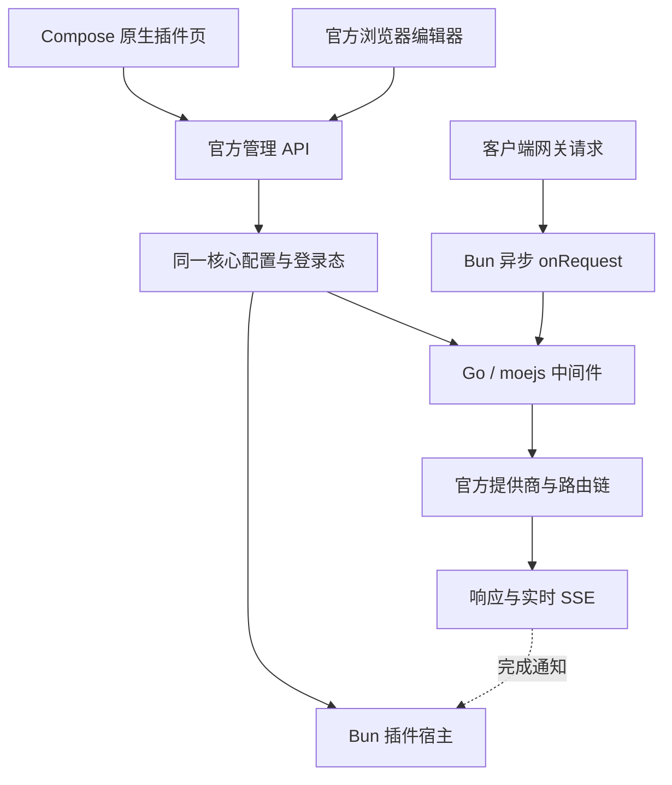

# 官方外部插件适配计划

本轮目标是接入官方外部插件的安装、运行和管理机制，覆盖社区 JS/TS 提供商／认证／工具、同步 JS 中间件、异步请求 Hooks。原生页面和官方浏览器页面共用核心配置。构建与运行测试全部交给 GitHub Actions，本地只做源码、资产及补丁检查。

本文是计划与验收要求，用户已授权按此目标持续实施。前序草稿继续补齐并由 GitHub Actions 验证，草稿存在不代表功能已通过验证。最终行为及运行说明见 [插件接入文档](official-plugin-integration.md)。

## 1. 技术路线与固定基线

- 实施起点：`17a1edd8f1e320231ba71743e954bb01ae37df96`，版本 `0.1.39-full-core-editors`。插件接入候选使用 `0.1.40-official-plugins`／code 41，核心 `0.1.3781-androidhost.2`。
- 上游：Magpie `v0.1.3781`，commit `b52c711142a662fe18fedf5a80cb1e4aa94bce62`；Go `1.26.8`。
- APK 继续使用完整官方源码的 `nogui,androidhost` 构建与官方管理网页，复用既有 Android 前台服务和进程监督。
- Bun 随 APK 固定版本与 SHA-256，使用 Android 对应的可执行载荷，从安装目录启动。

Android 和普通 Linux 的内核亲缘关系不能消除用户空间差异。普通 Linux 插件依赖可能要求 glibc／musl、Linux 动态链接器、shell、外部 CLI 或 `.node` 扩展；Android 使用 Bionic，并有自己的执行目录及应用权限规则。直接换 `GOOS=linux` 不会自动补齐这些依赖。

三类插件的官方入口和执行协议可以在现有 Android 完整核心上保留。实施先完成这条路线；具体插件若确实要求 Linux 原生依赖，再形成独立兼容方案，不预先把全部插件承诺为可运行。

## 2. 三类插件的精确定义

| 类别 | 官方发现方式 | 执行位置 | 必须验证的行为 |
| --- | --- | --- | --- |
| 社区提供商、认证、工具 JS/TS | npm／GitHub 包、本地脚本或目录；保留官方工厂、auth、provider、config、tool 等接口 | 共享 Bun host；Go 与 Bun 用 stdin/stdout JSON 协议通信 | 登录、模型发现、非流式与流式请求、工具参数与执行结果 |
| 同步 JS 中间件 | `package.json` 的 `magpie.middleware`／`magpie.gateway`；或 `*.middleware.js/mjs`、`*.gateway.js/mjs` | Go 网关进程内的 moejs | 请求改写／拒绝、响应或 SSE 事件处理、调用计数、异常与超时 |
| 异步请求 Hooks | `package.json` 的 `magpie.hooks`；或 `*.hooks.js/mjs/ts/mts` | Bun host | `await onRequest`、请求改写、`onResponse` 通知、状态关联、取消与超时 |

单个包可能同时提供多项能力，界面允许显示多个类型标签。自定义插件页面属于额外能力，不能用它代替异步 Hooks 的第三类验收。`plugins.yml` 管理内置 Go 插件，不作为外部安装清单。

## 3. 安装与持久化

核心继续维护 `plugins.json`、`plugins/` 依赖目录和 `plugin-auth.json`。Kotlin 保存 UI 偏好和必要的待核对操作标记，不另建可与核心冲突的插件配置库。

### npm 与 GitHub

- 使用官方 `/api/plugins/{op}` 安装、更新和移除，保留核心 spec 解析、来源与版本信息。
- npm 包、固定版本及 GitHub 固定引用分别验收。安装命令沿官方行为使用 `--ignore-scripts`。
- 先验证 Bun 在 Android 上实际获取 GitHub 包及依赖的能力；如果某种 Git spec 要求系统 git／ssh，再为该来源确定适配，不把“核心识别 URL”当作安装成功。
- 展示安装版本与最新版本，更新由用户触发。验证失败后的真实磁盘状态；官方更新会改变固定版本 spec，不能承诺未经实现的锁版本或自动回滚。

### Android 文件与目录导入

- 系统 SAF 选择文件／目录，完整复制到 App 私有 `plugin-imports/<uuid>` 快照。
- 单文件保留文件名，特别是 `.middleware.*`、`.gateway.*`、`.hooks.*` 后缀；目录保留入口及相对文件，要求 `package.json`。
- 先暂存、全部复制成功再发布；处理文件数、总大小、目录层级、重复名称和路径穿越。复制失败清理暂存。
- 官方本地路径安装仅引用文件，**不会安装该目录的依赖**。需在 Android 宿主导入目录范围内补充 `bun install --ignore-scripts`，成功后再交官方 Add。
- 含相对 import 的独立脚本使用目录导入；纯中间件依然遵守 moejs 的相对导入／预打包规则，安装 npm 依赖不能把 moejs 变为 Node 运行时。
- 核心确认删除后才回收快照。确定安装失败、结果未知和网页删除后的残留分别对账，避免删掉仍被使用的文件。

## 4. 网关与登录适配

### 插件访问本机网关

现有 APK 对本机请求也要求有效网关 Key；部分官方插件使用空授权或 `Bearer magpie`。需要在宿主中适配这项差异，保留第三方插件原始接口。

- 由核心签发独立插件调用 Key，管理凭据与应用聊天 Key 不用于该桥。
- 仅在 Android 完整宿主启用，限定当前网关的精确 origin。
- 只有缺少授权或授权为官方占位值时注入；其他显式授权原样保留。
- 跨 origin 重定向不得带出注入的 Key；用实际 HTTP 服务验证，而非只匹配脚本文本。
- 明确定义签发、有效期、停用、撤销、进程重启及恢复语义；用户撤销不能被后台静默签发替代 Key 抵消。
- 覆盖 URL／Request／init 参数组合。Node HTTP、WebSocket、自定义 fetch、raw socket、子进程不自动受 global fetch 桥覆盖，按代表插件的真实调用路径验证。
- 同 UID Bun 插件不是沙箱。私有脚本中的 base64 不是保密措施，不能宣称插件无法接触凭据。

### 登录

- 使用官方 provider `pid`、prompt、signin、state、callback、cancel 端点。
- 支持动态文本／选择提示、API Key、设备码、浏览器 OAuth、轮询及粘贴回调。
- 浏览器通过现有 Android 外部打开机制进入服务商页面；回调适配保留官方 state 校验、取消与超时。
- 登录成功刷新提供商、模型和插件状态；后台／旋转／返回浏览器及核心重启不能让旧响应覆盖新会话。
- URL、API Key、回调值、令牌不进入 SavedState、普通日志或备份。真实第三方账号的服务端登录仍需对应账号验收，模拟 OAuth 只证明宿主流程。

## 5. 原生 UI 与双编辑一致性

使用 `anthropic-style-frontend-cn` 的工具优先模式，沿用现有暖纸色、陶土橙、Poppins／Lora／中文文楷与 Compose 令牌。布局采用紧凑的列表和独立详情页，参考 RikkaHub 的层次组织。

- 主页：运行时简要状态、已安装／发现两页签、搜索与安装入口。
- 安装：npm／GitHub 输入、文件选择、目录选择；显示处理中、成功、失败与结果待核对。
- 列表：名称、来源／版本、能力标签和核心状态。区分已安装、已启用、加载失败、待登录；不把启用状态描述为真实请求已验证。
- 详情：连接与工具、参数、诊断。显示官方工具名称、MCP 地址及中间件／Hooks 诊断，参数 JSON 编辑保留未知字段。
- 登录：依插件真实方法动态生成交互。复杂详情与登录适应小屏、键盘、大字体、深浅色和旋转，避免长内容被固定高度弹窗截断。
- 保留官方浏览器编辑入口。返回应用重读插件、提供商和模型，以核心状态为准。
- 编辑 options 前后校验快照只能发现部分冲突，不能保证原子性。若要求阻止并发覆盖，给核心保存路径增加可选 revision 校验，浏览器和原生共用；测试同时编辑的真实竞态。
- 写入超时或连接中断后只读核对，不自动重放安装、更新、登录、删除。旧会话的完成响应必须被丢弃。

## 6. 实施状态与剩余验收

| 阶段 | 工作与主要文件 | 当前情况 | 进入下一阶段的门槛 |
| --- | --- | --- | --- |
| P1：客户端契约 | `PluginModels.kt`、`PluginManagementClient.kt`、`NativeCoreSession.kt` | 官方响应、鉴权、登录、未知写及完整宿主提供商协商已通过 JVM 验收 | 后续客户端改动以对应提交的 JVM 结果为准 |
| P2：宿主与导入 | `patches/mobile`、`PluginImport.kt`、`GatewayService.kt` | 网关桥与 Key 生命周期、目录依赖、SAF 文件／目录在真实 Android 核心通过 | 导入日志、明确拒绝／未知删除对账、网页删除回收均已通过对应 JVM／Android Actions |
| P3：原生管理 | `PluginManagementViewModel.kt`、`PluginManagementPanel.kt`、`NativeNavigation.kt` | 原生参数保存、API Key 登录、返回、后台／Activity 重建、1.3 倍字体均通过 Android instrumentation | XML 与截图已保存；后台恢复、字体变化与停止后的进程清理已通过 |
| P4：运行回归 | 官方插件 smoke、Android instrumentation、workflow | Linux 完整 Go+Bun、race、Android x86_64 三类插件实际运行均通过 | ARM64 实际运行须另有设备或兼容模拟器证据 |
| P5：候选 APK 与发布 | 构建／发布 job、版本、说明和验收报告 | 同一提交的固定签名、载荷哈希、PIE／16 KB 和候选发布通过 | 最新实现的构建、运行与发布已在同一 SHA 上通过 |

完整通过基线为 [`654ce191` Actions](https://github.com/fplj-fplj/magpie-mobile/actions/runs/43677903987)，[候选发布](https://github.com/fplj-fplj/magpie-mobile/releases/tag/v0.1.40-official-plugins-654ce191)与该 SHA 对应。Android XML 为 1 test、0 failure／error／skipped，停止结果明确确认 Go 与 Bun 进程全部退出。该轮同时验证导入回收补丁；后续提交仍以自身结果为准。

已覆盖的社区包为 `@magpie-community/tools-calc@0.1.0`、`@magpie-community/middleware-word-guard@0.1.1`、`@magpie-community/gateway-powercontext@0.2.1` 和固定提交的 `guotree/magpie-websearch`。验证包含计算工具精确结果、中间件拒绝与响应／SSE 变换、Hooks 异常／超时／取消、PowerContext 真实召回／会话关联／完成后写入、网关桥撤销和显式恢复。PowerContext 允许在插件 options 中提供 `authorization`，环境变量是它的回退路径。

剩余工作是取得 ARM64 实际运行证据。ARM64 hosted runner 没有 `/dev/kvm`，没有注册的真机 runner；独立 x86 主机 ARM64 软件模拟实验尚未启动成功。个人账号服务端登录仍需对应账号验收，不能由模拟 OAuth 代替。

## 7. GitHub Actions 验收矩阵

| 验收项 | 测试方法 | 通过证据 |
| --- | --- | --- |
| 安装来源 | 固定 npm 包、固定 GitHub 引用、SAF 单文件和带依赖目录分别安装 | 依赖文件存在、核心清单正确、插件实际加载；失败不留半成品注册 |
| 提供商与认证 | 官方接口的测试插件、模拟 OAuth／API Key／取消；本机 HTTP 测试上游 | 模型可见、授权态正确、真实核心非流式与 SSE 返回预期结果 |
| 工具 | 插件经 `/mcp/magpie/tools` 的 tools/list、tools/call | 实际执行输出、参数校验、停用后不能执行、调用鉴权 |
| 同步中间件 | 发网关请求，测试改写、reject、响应／SSE 事件 | 上游收到修改后的请求，客户端收到预期拒绝或变换，计数增长 |
| 异步 Hooks | await 本机 HTTP 服务后改写请求，完成后观察 onResponse | 修改真正到达上游、状态关联正确、SSE 实时到达、完成通知及取消／超时符合官方语义 |
| 代表社区插件 | 锁定上游推荐的提供商／工具、中间件与公开 Hooks 插件版本／提交 | 与测试插件分开记录；安装／加载／真实服务调用分别列出结果 |
| 双编辑 | 网页改 options／停用后返回原生；原生保存后网页重读 | 同一核心配置；并发编辑行为符合实际保护机制 |
| Android 生命周期 | 启停、旋转、后台返回、宿主中断与重启 | 不重复写入、不接受旧响应、停止后没有遗留核心／Bun 进程及监听端口 |
| 原生 UI | instrumentation 操作安装页、详情、登录和返回 | Android 测试报告与截图，可核对小屏与字体布局 |
| 生产载荷 | ARM64 ELF、PIE、16 KB 对齐、APK 打包哈希与证书验证 | 签名 APK 与构建证据对应同一 SHA |

CI 分层：Python 补丁／资产检查 → JVM 与 Go 契约／回归 → Linux 上真实 Go+Bun 宿主插件 smoke → Android x86_64 APK 模拟器运行 → ARM64 生产载荷与运行验收 → 发布。

Linux smoke 能证明核心协议链路，x86_64 Android 模拟器能证明 Android 宿主执行；二者都不能替代 ARM64 实际运行证据。当前没有已验证的 ARM64 真机 runner／设备农场。实施需安排真实 ARM64 设备验证并保存结果；取得证据前可以产出候选 APK，但不声明 ARM64 三类插件全面通过。付费／个人账号的第三方请求也应与可自动运行的本机测试上游分开记录。

发布 job 依赖构建和运行测试，下载同一提交的签名 APK 及完整构建证据。任何关键验收失败不得沿旧流程仅凭 APK 编译成功直接发布。

## 8. 源码依据

- [既有完整核心与双编辑路线](full-core-dual-editors.md)。
- [固定上游插件安装与配置](https://github.com/yetone/magpie/blob/b52c711142a662fe18fedf5a80cb1e4aa94bce62/internal/plugin/store.go)。
- [固定上游 Bun 宿主](https://github.com/yetone/magpie/blob/b52c711142a662fe18fedf5a80cb1e4aa94bce62/internal/plugin/host.go)。
- [固定上游中间件发现](https://github.com/yetone/magpie/blob/b52c711142a662fe18fedf5a80cb1e4aa94bce62/internal/plugin/middleware.go)与[执行引擎](https://github.com/yetone/magpie/blob/b52c711142a662fe18fedf5a80cb1e4aa94bce62/internal/middleware/middleware.go)。
- [固定上游异步 Hooks](https://github.com/yetone/magpie/blob/b52c711142a662fe18fedf5a80cb1e4aa94bce62/internal/plugin/gateway.go)。
- [固定上游插件管理 API](https://github.com/yetone/magpie/blob/b52c711142a662fe18fedf5a80cb1e4aa94bce62/internal/gui/plugins.go)。
